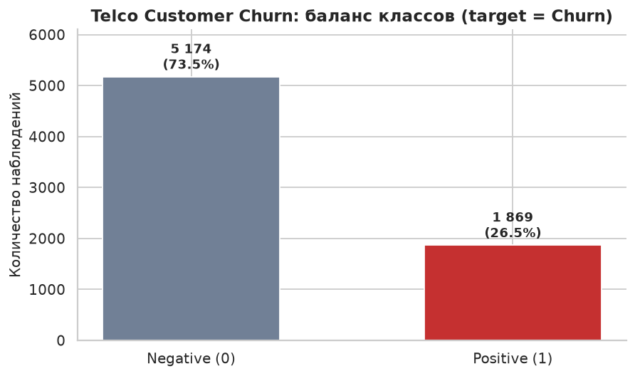
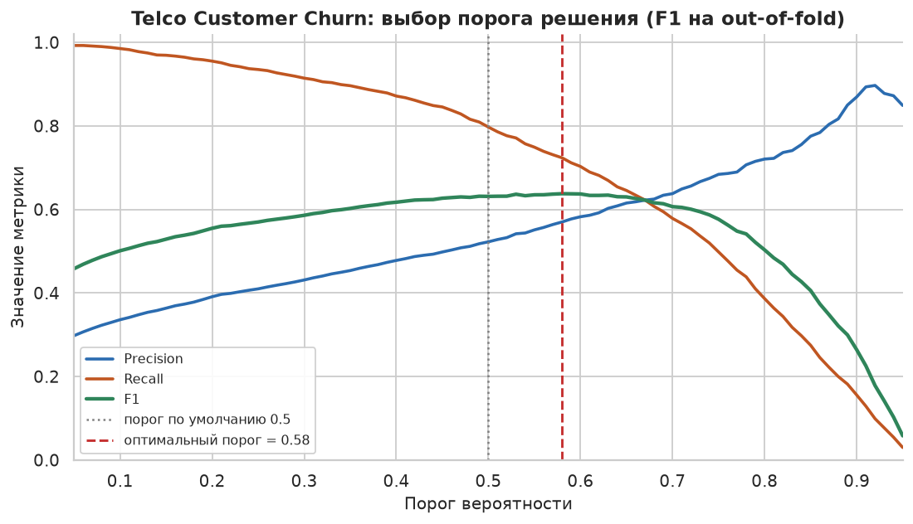

# Слайд 1 — Титульный

## Разработка и автоматизация пайплайна машинного обучения для задачи бинарной классификации

**Дисциплина:** Введение в науку о данных
**Профиль:** DevOps-инженерия

| Роль | Участник | Вклад |
|---|---|---|
| Data Scientist / Researcher | *(ФИО)* | EDA, feature engineering, обучение и оценка моделей, интерпретация |
| ML Engineer / DevOps Engineer | *(ФИО)* | архитектура кода, тесты, линтинг, DVC, CI, документация |

**Материалы:** репозиторий GitHub · `reports/REPORT.md` · 3 ноутбука · 19 графиков

---

# Слайд 2 — Постановка задачи и данные

## Две задачи бинарной классификации

||||
|---|---|---|
||**Telco Customer Churn**|**Bank Marketing**|
|**Бизнес-вопрос**|Уйдёт ли клиент телеком-компании?|Подпишется ли клиент на депозит после звонка?|
|**Источник (Kaggle)**|blastchar/telco-customer-churn|henriqueyamahata/bank-marketing|
|**Записей**|7 043|41 188|
|**Признаков**|20|20|
|**Целевая**|`Churn` = Yes/No|`y` = yes/no|
|**Дисбаланс**|73.5% / **26.5%**|88.7% / **11.3%**|
|**Изюминка**|11 пропусков, категориальный доминант|**утечка данных** в `duration`|

**Итого 48 231 наблюдение, 40 признаков.** Зачем два датасета: разный уровень
дисбаланса и разные «ловушки» — проверяем, что методология устойчива,
а не подогнана под один датасет.

---

# Слайд 3 — Главная находка EDA (Data Scientist)

## Тип контракта и стаж определяют отток

| Находка | Цифры |
|---|---|
| Контракт Month-to-month | отток **42.7%** против 2.8% у Two year |
| Стаж 0–10 месяцев | отток **~50%**, после 4 лет — **~10%** |
| Electronic check | отток **45.3%** против 15% у автоплатежей |
| Fiber optic | отток **41.9%** против 7.4% без интернета |

**Вывод:** риск ухода концентрируется в сегменте «новый клиент + месячный контракт + ручная оплата» — это готовый адресный список для кампании удержания.

---

# Слайд 4 — Работа с проблемами данных (Data Scientist)

## Пропуски, выбросы, утечка

**1. Пропуски (Telco).** 11 пустых `TotalCharges` — все у клиентов с `tenure = 0`.
Это не «ноль оплат», а «счёт ещё не выставлялся» → медианная импутация **внутри
train-фолда** + признаки `avg_monthly_charge`, `is_new_customer`.

**2. Выбросы.** Правило 1.5·IQR: `tenure` — 0%, `MonthlyCharges` — 0%,
`TotalCharges` — 0%. Экстремальные значения — реальные клиентские сегменты,
не ошибки ввода → данные не фильтруем.

**3. Утечка данных (Bank).** `duration` (длительность звонка) известен только
**после** разговора, но имеет корреляцию 0.41 с целевой переменной:

| Модель LightGBM (CV=5) | ROC-AUC |
|---|---|
| без `duration` (честная) | 0.8023 ± 0.0072 |
| с `duration` (утечка) | **0.9504** ± 0.0019 |

→ Признак **исключён**: «фантомное» качество +0.148 ROC-AUC не работает в проде.

---

# Слайд 5 — Feature engineering

| Датасет | Новые признаки | Идея |
|---|---|---|
| **Telco** | `num_addons`, `tenure_group`, `avg_monthly_charge`, `charge_growth`, `has_family`, `is_electronic_check`, `is_new_customer` | клиентские сегменты риска, цена относительно стажа |
| **Bank** | `was_contacted_before`, `pdays_recency`, `campaign_log`, `season`, `macro_stress` | история кампаний, сентинел `pdays=999` → «никогда», сезонность |

**Три из пяти** важнейших признаков Telco и **два из пяти** у Bank — созданные
на этом этапе (по permutation importance). Feature engineering подтверждён
количественно, а не «на глаз».

Ключевой принцип: **все обучаемые преобразования — только внутри sklearn-pipeline**
(mean/scale/encode считаются на train и применяются к тесту без переобучения).

---

# Слайд 6 — Архитектура и автоматизация (ML Engineer)

| Слой | Модуль | Роль |
|---|---|---|
| Конфиг | `src/config.py` | пути, seed, реестр датасетов, SHA-256 |
| Данные | `download.py`, `datasets.py` | загрузка с проверкой контрольных сумм, очистка |
| Признаки | `features.py` | feature engineering |
| Препроцессинг | `preprocessing.py` | ColumnTransformer (fit на train) |
| Модели | `models.py`, `training.py` | 4 модели, CV, поиск гиперпараметров, порог |
| Оценка | `evaluation.py`, `plotting.py` | метрики, 19 графиков единого стиля |
| Оркестрация | `pipeline.py` | **всё одной командой** |

**Воспроизведение:** `bash scripts/run_all.sh` · `make pipeline` · `dvc repro`
**Качество:** 23 теста (pytest) · flake8 + black (0 замечаний) · CI на GitHub Actions
(smoke-прогон пайплайна на каждый push)

---

# Слайд 7 — Модели и честность сравнения

## 4 модели, 3 семейства, единая политика по дисбалансу

| Семейство | Модель | Обработка дисбаланса |
|---|---|---|
| Линейная | Logistic Regression | `class_weight='balanced'` |
| Бэггинг | Random Forest | `class_weight='balanced'` |
| Бустинг | XGBoost | `scale_pos_weight` |
| Бустинг | LightGBM | `class_weight='balanced'` |

**Схема оценки:** Stratified 80/20 → 5-fold CV → `RandomizedSearchCV`
для лучшей модели → подбор порога по out-of-fold F1 → финальная оценка на тесте.

**Три уровня защиты от утечек:**
1. препроцессинг обучается только на train-фолдах (покрыто тестом);
2. `duration` удалён до обучения;
3. порог подбирается на out-of-fold, тест не участвует в выборе решений.

---

# Слайд 8 — Результаты

## Метрики на тестовой выборке

**Telco Churn** (1 409 записей)

| Модель | Accuracy | Precision | Recall | F1 | ROC-AUC |
|---|---|---|---|---|---|
| **LogReg (tuned) @ порог 0.58** | 0.774 | 0.556 | 0.746 | **0.637** | **0.848** |
| XGBoost | 0.759 | 0.534 | 0.730 | 0.617 | 0.835 |
| LightGBM | 0.776 | 0.563 | 0.695 | 0.622 | 0.828 |
| Random Forest | 0.758 | 0.534 | 0.693 | 0.603 | 0.834 |

**Bank Marketing** (8 238 записей)

| Модель | Accuracy | Precision | Recall | F1 | ROC-AUC |
|---|---|---|---|---|---|
| **XGBoost (tuned) @ порог 0.19** | 0.878 | 0.469 | 0.603 | **0.528** | **0.817** |
| XGBoost @ порог 0.50 | 0.901 | 0.690 | 0.227 | 0.342 | 0.817 |
| LightGBM | 0.853 | 0.405 | 0.647 | 0.498 | 0.809 |
| Logistic Regression | 0.835 | 0.368 | 0.647 | 0.469 | 0.801 |

**Ключевой вывод:** у лучшей по ROC-AUC модели Bank F1 при пороге 0.5 был
**наихудшим** (0.342). Подбор порога поднял F1 до 0.528 (+0.19) и recall в 2.7 раза —
**порог решения не менее важен, чем выбор модели.**

---

# Слайд 9 — Интерпретация и выводы

## Что позволяет прогнозировать модель

| # | Telco (падение ROC-AUC) | Bank (падение ROC-AUC) |
|---|---|---|
| 1 | `Contract` (−0.038) | `nr.employed` (−0.047) |
| 2 | `tenure` (−0.025) | `emp.var.rate` (−0.033) |
| 3 | `tenure_group` *(−0.011, созданный)* | `euribor3m` (−0.012) |
| 4 | `InternetService` (−0.009) | `contact` (−0.011) |
| 5 | `is_new_customer` *(−0.006, созданный)* | `cons.price.idx` (−0.009) |
| **Рычаг бизнеса** | управляемые признаки: контракт, стаж, доп. услуги | макро-фон определяет *когда*, признаки кампании — *кого* звать |

**Проверенные гипотезы:** утечка `duration` (подтверждена), непригодность
Accuracy при дисбалансе (подтверждена), неоптимальность порога 0.5
(подтверждена). **Опровергнуто:** «бустинг всегда лучше линейной модели» —
на Telco логистическая регрессия победила (0.848 против 0.828–0.835) и оказалась
ещё и дешевле в сопровождении; «accuracy годится как метрика permutation
importance» — при `class_weight='balanced'` важности получаются отрицательными,
корректный порядок даёт ROC-AUC.

**Главный вывод:** в обеих задачах качество, пригодное для пилота —
модель ранжирует клиентов по вероятности события и позволяет направлять
ограниченный бюджет удержания/кампании в верхний дециль риска.

---

# Слайд 10 — Трудности, решения и развитие

| Трудность | Решение |
|---|---|
| Kaggle недоступен без API-ключа | зеркала, привязанные к коммитам, + проверка SHA-256 |
| `TotalCharges` строковый, `pdays=999` — сентинел | приведение типов, NaN + отдельный признак давности |
| Скрытая утечка `duration` | обнаружена на EDA, удалена, эффект измерен (0.95 → 0.80) |
| Дисбаланс 89/11 искажал сравнение | единая политика `class_weight`/`scale_pos_weight` |
| Долгие прогоны на 2 CPU | `--skip-tuning`, `n_jobs=-1`, кэш DVC |
| Устаревший API `penalty` в sklearn ≥1.8 | переход на `l1_ratio` |

**Направления развития:**
1. MLflow — трекинг экспериментов;
2. FastAPI + Docker — деплой модели как сервиса;
3. автоматическое переобучение и мониторинг дрейфа (PSI/KS);
4. калибровка вероятностей и оптимизация порога по **стоимости ошибок**;
5. SHAP/PDP для объяснения решений по каждому клиенту.

**Воспроизведение проекта — одна команда:** `bash scripts/run_all.sh`
